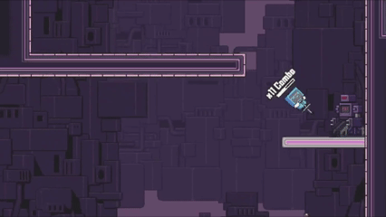
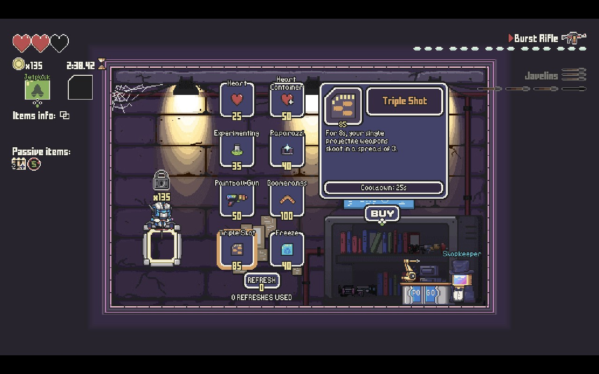
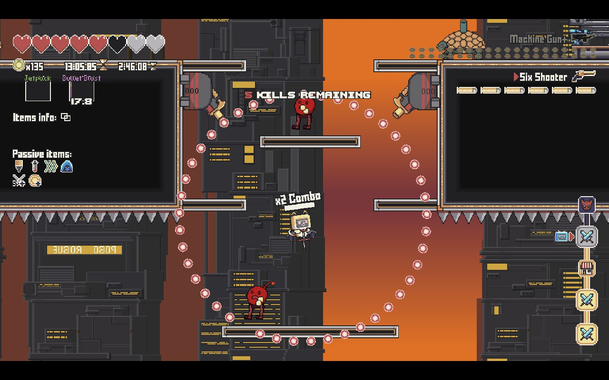
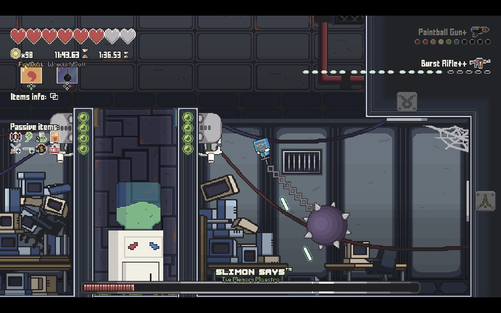

# Pogo Rogue

**A skill-based roguelite platformer where your gun is your pogo stick.**

*Pogo Rogue* is a free action roguelite built in GameMaker by **Bounce Back Games**, a studio of about 30 University of Utah students who made it as their capstone project. Players bounce upward through procedurally generated levels, firing downward to launch themselves higher. Along the way they stomp and shoot enemies, collect weapons and items, and take on multi-phase bosses. It launched in Steam Early Access in April 2024 and fully released on November 21, 2024, where it holds a **Very Positive** rating.

   
   <a href="https://store.steampowered.com/app/2870280/Pogo_Rogue/">Play free on Steam</a>

> **About this repo:** this is the development repository for *Pogo Rogue*. It holds the full GameMaker project: code, sprites, rooms, and audio.

---

## Features

- **Pogo movement:** shooting propels you, so every weapon is both an attack and a movement tool
- **Two ways to fight:** stomp enemies from above or shoot them down
- **Build variety:** two weapons and two active items at a time, plus unlimited stacking passives with item synergies
- **38 weapons and 40+ passive items,** from pistols and shotguns to lasers and yo-yos
- **Procedurally generated levels** across three themed phases, with combat rooms, a shop, and a boss portal in every run
- **Multi-phase bosses,** the Marionette, the Sphere, and the Sequence
- **Full keyboard and gamepad support** with rebindable controls

## How it works

### Player & movement

The player is a state machine with more than 20 states, each self-contained: bouncing, charge jumping, ground pounding, grappling, parachuting, dashing, and more. A bounce plays a short compress animation before launching, and the player steers by tilting in the air, with tilt speed adjustable in settings. Firing a weapon pushes the player opposite to the shot. Each weapon sets its own kick and how much momentum each bullet adds, so aiming down is how you climb. Ammo refills on every bounce, which turns each landing into a small decision between shooting, stomping, and repositioning.

### Weapons, items & synergies

Every weapon is defined as data: bullets per bounce, spread, burst, inaccuracy, kick, momentum, and ammo type. New guns can be added and balanced without touching the shooting code. Weapons can be upgraded at the Pogosmith's workbench, and each upgrade level changes the weapon's behavior, not just its damage. For example, the burst rifle fires longer bursts as it is upgraded.

Active items work the same way. Each one is a small definition that declares its cooldown, which player states it can be used in, and an `on_call` function that does the work. Carrying two specific actives can unlock one of 10 synergies, combined items with their own effects, such as Pogo Mode or Harpoon Helmet. On top of that, 40+ stacking passive items modify the player's stats and weapons for the rest of the run.

   
  <i>The shop, where coins buy weapons, active items, and healing</i>

### Enemies

All enemies inherit from a shared parent that handles health, invincibility frames, damage flashing, and loot. Each enemy then adds its own behavior: flying, jumping, charging, shooting, exploding, burrowing, and more. Separate damage scalars for stomps, bullets, and explosions let designers make enemies resistant to one play style, which pushes players to mix up their approach. Killing enemies in quick succession builds a **combo** that multiplies the coins they drop.

   
  <i>A locked combat room: clear the kill count to open the gates, and chain kills to build a combo</i>

### Bosses

Each phase ends in a boss built around its own mechanic:

- **The Sequence:** a memory boss that shows a pattern the player has to reproduce. Each time its health crosses a third, the pattern gets longer.
- **The Marionette:** a physics-driven puppet. It swings from an anchor on a damped spring, with separately simulated arms and legs, and it fights using the player's own abilities and weapons.
- **The Sphere:** a rotating core that breaks apart into pieces the player has to deal with.

   
  <i>Fighting Slimon Says, the Memory Maestro</i>

### Procedural level generation

The level generation system turns hand-drawn room "blueprints" into a different level on every run.

**1. Laying out the level.** Each level starts as a coarse grid. Rooms are placed in order (start room, combat rooms, shop, boss portal), each one higher than the last with a random horizontal offset and gap. They're joined by winding hallway room cells biased upward, so the level always climbs. All randomness runs from a single seed, so any run can be reproduced exactly.

**2. Choosing hallway pieces.** Each hallway cell looks at its neighbors and picks the right chunk type: vertical, horizontal, or a corner. Long straight runs are merged into larger two-cell chunks. Mirroring right-to-left sections doubles the variety of chunks without extra authoring.

**3. Rooms drawn as pixel art.** Designers build every room as a small image in which each pixel's color is an instruction:

| Color | Becomes |
|---|---|
| ⬜ White | Player start |
| 🟥 Reds | Enemies (each shade is a specific enemy type, and pure red is random) |
| 🟩 Greens | Chests, shop door, boss door |
| 🟦 Blues | Hazards: fans, spikes, conveyors, electric floors, bumpers |
| ⬛ Black / brown | Solid ground / one-way platforms |

At load time the game reads each image pixel by pixel and spawns the matching objects. Designers can lay out and iterate on rooms in any image editor, with no code changes and no fiddly editor placement.

**4. Keeping it fast.** Generated levels are large, so the generator merges runs of ground pixels into the fewest rectangular wall objects possible rather than creating one per tile. At runtime, the level is split into regions that load and unload as the player climbs, so only nearby enemies and objects run logic.

**5. Tooling for designers.** Debug tools analyze how often each chunk type appears across many generated levels. A "signature" system tags every chunk with the designer who made it, which makes playtest feedback easy to route to the right person.

### Progression, settings & input

Unlocked items, save data, and control bindings are saved between sessions, so new weapons and items join the drop pool as players progress. The game supports keyboard, mouse, and gamepad with fully rebindable controls. On-screen prompts switch to match whichever device is in use, and the settings menu covers audio, video, and gameplay options such as tilt speed.

## Tech

| | |
|---|---|
| **Engine** | GameMaker (IDE 2024.6) |
| **Language** | GML |
| **Platforms** | PC (Steam) |
| **Development** | 2023 - 2024 University of Utah EAE capstone |

## Running the project

1. Install [GameMaker](https://gamemaker.io/) (2024.6 or newer).
2. Clone this repo.
3. Open `Pogo_Rogue_Alpha.yyp` and press **Run**.

## Team

*Pogo Rogue* was made by **Bounce Back Games**, a team of University of Utah students.

| Role | Team members |
|---|---|
| **Character / Items Team** | |
| Artists | Hannah Suchil, Isaac White, Jiale Wei, Zekai Lu, Ziteng Zhao |
| Designers | Isaac White, Mingzhe Zhu, Yuguang Shi |
| Engineers | Erik Zhang, Isaac White, Yuguang Shi |
| Player Mechanics Engineer | Isaac White |
| Producers | Cleveland Parker, Ian Vokt, Isaac White |
| **Enemies Team** | |
| Artists | Christian Almond, Karsten Weller, Kim Nguyen |
| Designers | Daniel He, Yuguang Shi, Zehao Chen |
| Engineers | Bingyan Xie, Daniel He, John Richard, Yuguang Shi |
| Producer | John Richard |
| **Level Team** | |
| Artists | Daming Li, Hyeongkyu Kim |
| Designers | Ian Vokt, Sam Klopstad, Talen Stephens, Zehao Chen |
| Engineers | Cam Knight, Cayden Jensen, Regie Topham |
| Proc Gen Engineers | Cam Knight, Cayden Jensen |
| Producer | Regie Topham |
| **UI** | |
| UI Artists | Hannah Suchil, Hyeongkyu Kim, Isaac White, Zekai Lu, Ziteng Zhao |
| UI Designer | Isaac White |
| UI Engineer | Isaac White |
| **Art** | |
| Background Artists | Daming Li, Zekai Lu |
| CG Artists | Christian Almond, Zekai Lu |
| Promotional Artists | Daming Li, Kim Nguyen |
| Art Polish Team | Daming Li, Kim Nguyen, Zekai Lu, Ziteng Zhao |
| **Audio** | |
| Music Composer | Daisy Dai |
| Sound Designer | Josiah Lin (LilLin) |
| Audio Director | Josiah Lin (LilLin) |
| **Production** | |
| Marketing Manager | Cleveland Parker |
| User Researcher | Ian Vokt |
| Art / Narrative Producer | Cleveland Parker |
| Design Producers | Ian Vokt, Isaac White |
| Engineering Producers | John Richard, Regie Topham |
| General Producers | Cleveland Parker, Ian Vokt, Isaac White, John Richard, Regie Topham |

Made with guidance from professors Fernando Rodriguez and Greg Bayles, in partnership with the Berklee College of Music.

---

© Bounce Back Games

Consult README changes with Cam Knight
